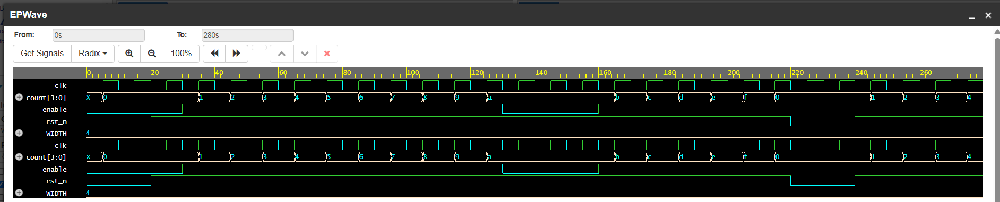

# Task 2: Clocked Counters and Registers

## Overview
Designed, simulated, and verified a synchronous clocked counter and register block using Verilog HDL. The module incorporates an active-low synchronous reset (`rst_n`) and a count enable signal (`enable`).

## Features & Verification
* **Synchronous Reset:** Resets counter value to 0 on the positive clock edge when `rst_n` is low.
* **Enable Control:** Increments counter value only when `enable` is high; holds current state when low.
* **Boundary & Rollover Testing:** Verified normal counting behavior, reset assertion, and maximum-value rollover.

## Repository Contents
* `counter.sv` - RTL source code for the clocked counter module.
* `testbench.sv` - Testbench applying clock generation, reset sequence, and enable stimulus.
* `Screenshot 2026-11-09 200527.png` - Simulation waveform proof verifying signal behavior.

## Tools Used
* **Simulator:** Icarus Verilog (via EDA Playground)
* **Waveform Viewer:** EPWave

## Waveform Proof

